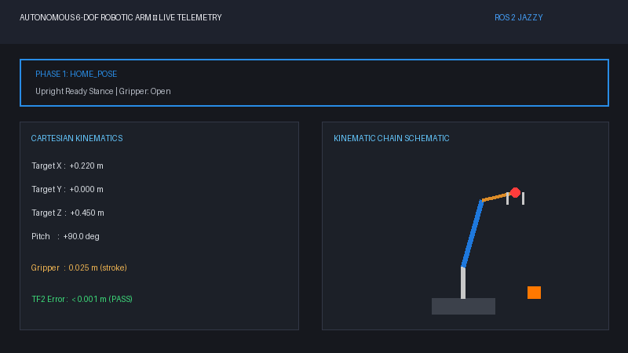

# Autonomous 5-DOF Robotic Arm & Parallel Clamshell Gripper Pipeline

[](https://docs.ros.org/en/jazzy/)
[](https://gazebosim.org/)
[](https://moveit.picknik.ai/)
[](https://python.org)
[](https://isocpp.org)
[](LICENSE)

An end-to-end, modular ROS 2 robotic manipulation framework integrating a high-fidelity SolidWorks-exported 5-DOF robotic arm and parallel clamshell gripper. Features closed-form analytical kinematics, MoveIt 2 OMPL motion planning, Gazebo Sim Harmonic physics with `gz_ros2_control`, real-time TF2 coordinate telemetry, and autonomous pick-and-place task execution.

---

## Demonstration



---

## System Architecture

The workspace is organized into five decoupled, production-grade ROS 2 packages adhering to the standard ROS 2 robotics stack layout:

```text
robotic_arm_ws/
├── src/
│   └── custom_arm/
│       ├── custom_arm_description/    # SolidWorks STL visual & collision meshes, URDF/Xacro kinematics, RViz2
│       ├── custom_arm_moveit_config/  # SRDF planning groups, KDL kinematics, OMPL planners, controller bindings
│       ├── custom_arm_gazebo/         # SDF 1.8 worlds, ODE physics, table & cube spawning, clock bridge
│       ├── custom_arm_control/        # ros2_control controller manager & FollowJointTrajectory configs
│       └── custom_arm_kinematics/     # MoveIt IK client, TF2 telemetry listener & 7-phase state machine
├── media/                             # High-resolution demonstration GIFs and media assets
├── run_demo.sh                        # One-command dual-stage orchestrator
├── setup_shortcuts.sh                 # Global bash alias installer
├── record_demo.sh                     # Automated X11 recording and 2-pass GIF converter
└── README.md
```

### Package Manifest Breakdown

| Package | Build Type | Core Responsibilities & Interfaces |
| :--- | :--- | :--- |
| **`custom_arm_description`** | `ament_cmake` | High-fidelity SolidWorks STL visual and collision meshes, exact CAD inertia tensors, joint dynamics, `gz_ros2_control` hardware interface tags, and RViz inspection pipeline. |
| **`custom_arm_moveit_config`**| `ament_cmake` | Semantic description (`robot.srdf`), KDL kinematics plugin, OMPL planners (`RRTConnect`, `RRTstar`, `PRM`), Pilz Cartesian limits, and MoveIt execution controllers. |
| **`custom_arm_control`**      | `ament_cmake` | `controller_manager` configuration (100 Hz), `JointStateBroadcaster`, and `JointTrajectoryController` for the 5-DOF arm and parallel gripper. |
| **`custom_arm_gazebo`**       | `ament_cmake` | SDF 1.8 physics environment (`pick_and_place.world`), ODE solver settings, calibrated work table, target graspable orange cube, destination basket, and `ros_gz_bridge`. |
| **`custom_arm_kinematics`**   | `ament_python` | Analytical geometric IK solver, `/compute_ik` service client, MoveGroup action client, TF2 coordinate validator, and 7-stage automated pick-and-place state machine. |

---

## Hardware Specifications & Kinematic Chain

The robot arm geometry and inertial parameters are derived directly from the custom SolidWorks CAD assembly (`robot_arm_urdf`):

### Link Mass Breakdown
- **Base Link (`base_link`)**: $17.152\,	ext{kg}$ (Heavy pedestal chassis ensuring dynamic stability)
- **Shoulder Bracket (`link_1`)**: $3.090\,	ext{kg}$
- **Upper Arm (`link_2`)**: $5.590\,	ext{kg}$ (Extended link with high torsional stiffness)
- **Forearm (`link_3`)**: $2.826\,	ext{kg}$
- **Wrist Pitch Assembly (`link_4`)**: $1.810\,	ext{kg}$
- **Wrist Mount (`link_5`)**: $0.191\,	ext{kg}$
- **Gripper Left Finger (`link_6`)**: $0.117\,	ext{kg}$
- **Gripper Right Finger (`link_7`)**: $0.117\,	ext{kg}$

### Kinematic Joint Specifications

| Joint | Parent $	o$ Child | Type | Axis | Range / Limits | Max Velocity | Effort | Function |
| :--- | :--- | :--- | :--- | :--- | :--- | :--- | :--- |
| `joint_1` | `base_link` $	o$ `link_1` | Revolute | $\hat{Z}$ | $[0.0, 3.142]\,	ext{rad}$ ($0^\circ 	ext{ to } 180^\circ$) | $3.0\,	ext{rad/s}$ | $200\,	ext{Nm}$ | Shoulder Pan |
| `joint_2` | `link_1` $	o$ `link_2` | Revolute | $\hat{Z}$ (local) | $[-1.57, 1.57]\,	ext{rad}$ ($-90^\circ 	ext{ to } +90^\circ$) | $3.0\,	ext{rad/s}$ | $200\,	ext{Nm}$ | Shoulder Lift |
| `joint_3` | `link_2` $	o$ `link_3` | Revolute | $\hat{Z}$ (local) | $[0.0, 3.142]\,	ext{rad}$ ($0^\circ 	ext{ to } 180^\circ$) | $3.0\,	ext{rad/s}$ | $200\,	ext{Nm}$ | Elbow Pitch |
| `joint_4` | `link_3` $	o$ `link_4` | Revolute | $\hat{Z}$ (local) | $[-3.142, 0.0]\,	ext{rad}$ ($-180^\circ 	ext{ to } 0^\circ$) | $3.0\,	ext{rad/s}$ | $200\,	ext{Nm}$ | Wrist Pitch |
| `joint_5` | `link_4` $	o$ `link_5` | Revolute | $\hat{X}$ (local) | $[0.0, 3.142]\,	ext{rad}$ ($0^\circ 	ext{ to } 180^\circ$) | $3.0\,	ext{rad/s}$ | $200\,	ext{Nm}$ | Wrist Roll |
| `joint_6` | `link_5` $	o$ `link_6` | Prismatic | $-\hat{Z}$ (local) | $[0.00, 0.03]\,	ext{m}$ ($0 	ext{ to } 30\,	ext{mm}$) | $0.1\,	ext{m/s}$ | $100\,	ext{N}$ | Left Finger Stroke |
| `joint_7` | `link_5` $	o$ `link_7` | Prismatic | $+\hat{Z}$ (local) | $[-0.03, 0.00]\,	ext{m}$ ($-30 	ext{ to } 0\,	ext{mm}$) | $0.1\,	ext{m/s}$ | $100\,	ext{N}$ | Right Finger Mimic (`-1`) |
| `tcp_joint` | `link_5` $	o$ `tcp` | Fixed | — | Origin: $(0.54, 0, 0)\,	ext{m}$ | — | — | Tool Center Point |

---

## Live Kinematics Telemetry & State Machine

The automated pick-and-place pipeline executes a 7-stage state machine against Gazebo Sim and MoveIt 2, streaming live telemetry to the terminal dashboard:

```text
┌──────────────────────────────────────────────────────────────────────┐
│ PHASE: Phase 2: APPROACH_CUBE                                        │
├──────────────────────────────────────────────────────────────────────┤
│ TCP Target Position [m]: X=-0.000 | Y=-0.488 | Z=-0.043              │
│ TCP Target Euler  [deg]: R=  -0.0° | P= -69.9° | Y= -90.0°           │
│ Joint Angles [deg]     : J1= +90.0° | J2= +25.8° | J3= +63.0°        │
│                          J4= -68.8° | J5= +90.0°                     │
│ Gripper State          : [Open  ] (Stroke:  0.030 m)                 │
│ Live TF delta error    : 0.0000 m (Pass: <0.002 m)                   │
└──────────────────────────────────────────────────────────────────────┘
```

### State Machine Lifecycle
1. **`HOME_POSE`**: Arm assumes upright ready posture ($[1.57, 0.0, 1.57, -1.57, 1.57]$), gripper open ($0.030\,	ext{m}$).
2. **`APPROACH_CUBE`**: Pre-grasp approach directly over target cube on the table ($X=-0.000\,	ext{m}, Y=-0.488\,	ext{m}, Z=-0.043\,	ext{m}$).
3. **`DESCEND_GRASP`**: End-effector descends to table height ($Z=-0.083\,	ext{m}$) and closes gripper around object ($	ext{stroke}=0.005\,	ext{m}$).
4. **`ELEVATE_OBJECT`**: Vertical Cartesian lift ($+0.12\,	ext{m}$ to $Z=+0.040\,	ext{m}$) securing the target cube.
5. **`TRANSFER_TO_BASKET`**: Smooth arc trajectory transferring the object to the destination basket ($X=-0.380\,	ext{m}, Y=-0.391\,	ext{m}, Z=+0.040\,	ext{m}$).
6. **`PLACE_AND_RELEASE`**: Lowers into basket ($Z=-0.083\,	ext{m}$) and opens gripper fingers ($0.030\,	ext{m}$).
7. **`RETRACT_HOME`**: Vertical retreat returning to safe `HOME_POSE` posture.

---

## Quick Start Guide

### 1. Prerequisites
Ensure ROS 2 Jazzy and Gazebo Harmonic are installed:
```bash
sudo apt update
sudo apt install -y ros-jazzy-desktop ros-jazzy-ros-gz ros-jazzy-gz-ros2-control ros-jazzy-moveit
```

### 2. Build Workspace
```bash
cd ~/robotic_arm_ws
source /opt/ros/jazzy/setup.bash
colcon build --symlink-install
source install/setup.bash
```

### 3. Install Global Shell Shortcuts
Run the shortcut configuration utility to enable one-word commands from any terminal:
```bash
bash setup_shortcuts.sh
source ~/.bashrc
```

Available shortcuts:
- `arm_build`: Rebuilds workspace with `colcon` and sources install directory.
- `arm_rviz`: Launches RViz2 with interactive joint sliders for URDF inspection.
- `arm_moveit`: Launches MoveIt 2 motion planning standalone demo.
- `arm_sim`: Launches Gazebo physics + MoveIt 2 + RViz in unified simulation.
- `arm_telemetry`: Runs the automated 7-stage pick-and-place sequence with live telemetry.
- `arm_ik_test`: Runs the 4-waypoint inverse kinematics solver and TF2 validation.

---

## Running the Complete Simulation & Demo

### Option A: One-Command Dual-Stage Orchestrator (Recommended)
Automatically initializes the Gazebo physics environment, validates controller health, and triggers the pick-and-place telemetry pipeline:
```bash
~/robotic_arm_ws/run_demo.sh
```

### Option B: Manual Side-by-Side Execution

#### Terminal 1 — Physics Simulation & Motion Planner
```bash
arm_sim
# Equivalent to: ros2 launch custom_arm_moveit_config moveit_gazebo.launch.py
```

#### Terminal 2 — Automated Pick-and-Place Telemetry Sequence
```bash
arm_telemetry
# Equivalent to: ros2 run custom_arm_kinematics pick_and_place_telemetry
```

---

## Screen Recording & GIF Export

To record live RViz / Gazebo demonstrations and produce optimized, lightweight GIFs for documentation:
```bash
~/robotic_arm_ws/record_demo.sh
```
The script captures the X11 display at 30 FPS and executes a two-pass palette optimization (`fps=15,scale=960:-1:flags=lanczos`), outputting the result directly to `media/demo.gif`.

---

## License

This project is licensed under the Apache 2.0 License. See [LICENSE](LICENSE) for details.

## Author & Maintainer

- **Atharva Dhawale**
- GitHub: [AtharvaDhawale](https://github.com/AtharvaDhawale)
- Built with ROS 2 Jazzy Jalisco, Gazebo Harmonic, and MoveIt 2.
